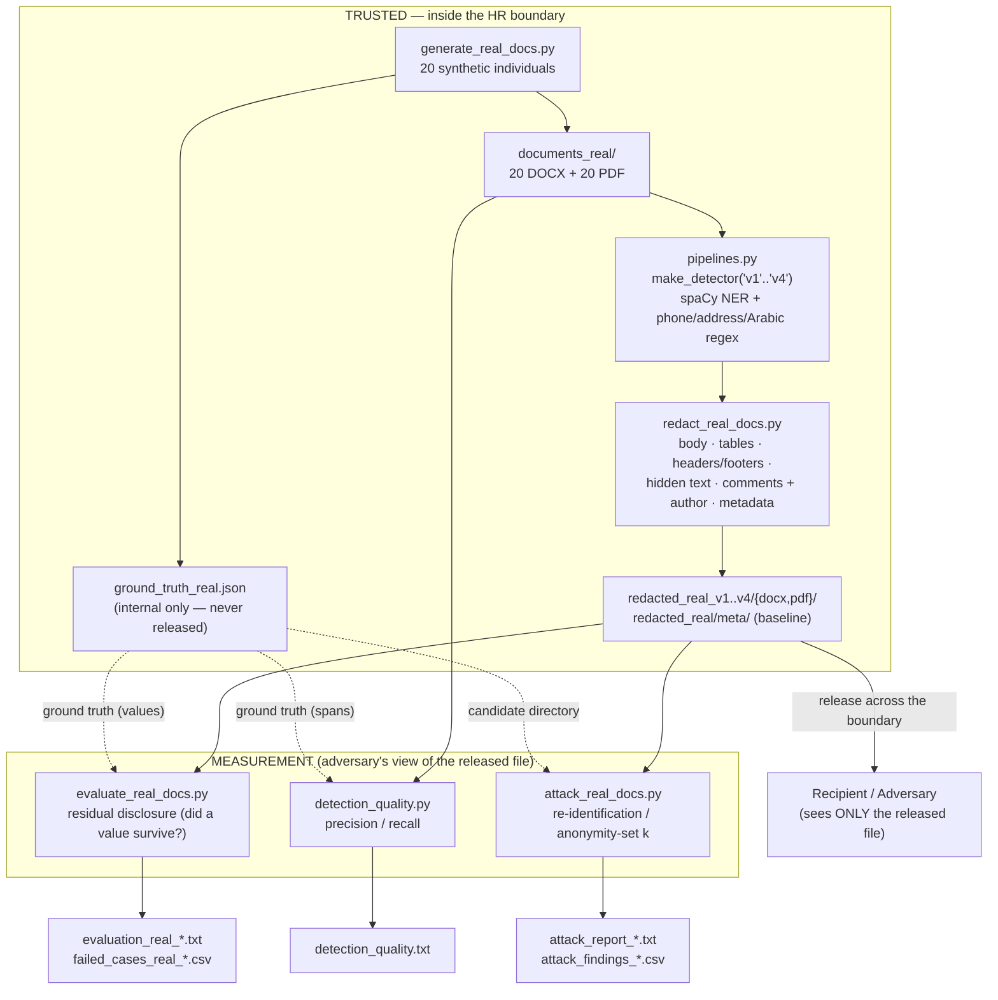

# Architecture & Data Flow

**Project 09 — Document Redaction & Metadata Privacy.** End‑to‑end pipeline from synthetic generation
to the two honest metrics (residual disclosure and re‑identification), with the trust boundary made
explicit. The verifier and the attacker see **only** the released file.

## Pipeline (generator → detect → redact → evaluate → attack)

## Trust boundaries

1. **HR boundary (trusted).** The original documents, the detectors, the redaction step, and
   `ground_truth_real.json` live inside. The ground truth is **never** released — it exists only to
   score protection.
2. **Release boundary (crossing into untrusted).** Only `redacted_real_v4/` (recommended) crosses to
   the recipient. Everything the recipient/adversary can do is modelled by reading **only** that file.
3. **Measurement plays the adversary.** `evaluate_real_docs.py` and `attack_real_docs.py` read every
   surface of the *released* file (body, headers/footers, hidden `w:vanish` / white PDF text, comments
   + comment authors, PDF annotations, and all metadata) — never the rendered page, never the original.
   `attack_real_docs.py` additionally links residual quasi‑identifiers against a candidate directory,
   which represents an attacker's **auxiliary knowledge**.

## Surface coverage (why "a box over the page" is not enough)

| Channel | Surfaces | Produced by | Inspected by |
|---|---|---|---|
| Visible body | paragraphs, tables | generator | evaluate, attack |
| Hidden / auxiliary | `w:vanish` text, white PDF text, headers/footers, comments (+ author), footnotes/endnotes, PDF annotations | generator | evaluate, attack |
| Metadata | `docProps` core/app/custom, PDF info dict, XMP | generator | evaluate, attack, check_metadata |

## Reproducibility

`run_all_real.py` runs the whole chain deterministically (fixed synthetic data, pinned
`requirements.txt`): redact v1–v4 → metadata‑only baseline → evaluate (original, v1–v4, meta) →
detection quality → re‑identification attack (original, meta, v1–v4). Re‑running regenerates every
evidence file identically.
