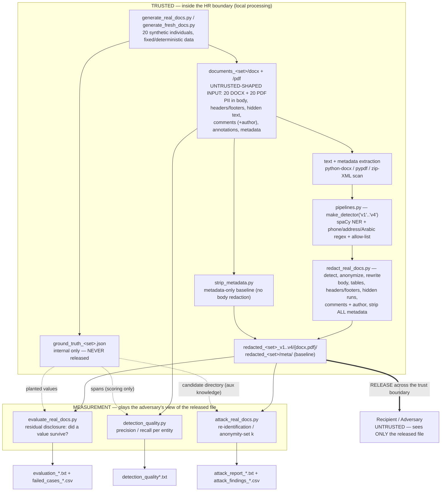

# Architecture & Data Flow

**CSE331 Project 09 — Document Redaction & Metadata Privacy.** End‑to‑end pipeline from the
synthetic generator to the two honest metrics (residual disclosure and re‑identification), with
**trust boundaries made explicit**. The verifier and the attacker see **only** the released file.

> **PNG export.** A PNG render of the diagram below is produced with
> `mmdc -i docs/architecture_dataflow.md -o docs/architecture_dataflow.png` when the Mermaid CLI
> (`mmdc`) is installed. `mmdc` is **not installed in this environment**, so no PNG is committed;
> GitHub renders the Mermaid block inline. (Install: `npm i -g @mermaid-js/mermaid-cli`.)

## 1. Data‑flow diagram (with trust boundaries)

## 2. Trust boundaries (marked explicitly)

1. **Untrusted input document.** Even though the generator is ours, each document is treated as an
   *untrusted container*: PII can hide on **any** surface (body, tables, headers/footers, hidden
   `w:vanish` / white PDF text, comments + comment‑author attributes, PDF annotations, and all
   metadata parts). The pipeline must reach every one of them, not just the visible page.
2. **Local processing (trusted).** Generation, extraction, detection, redaction, and the ground
   truth all live inside the HR boundary on the local machine. **`ground_truth_*.json` is never
   released** — it exists only to *score* protection.
3. **Release boundary (trusted → untrusted).** Only `redacted_<set>_v4/` (recommended) crosses to
   the recipient. Everything the recipient/adversary can do is modelled by reading **only** that
   file.
4. **Measurement plays the adversary.** `evaluate_real_docs.py` and `attack_real_docs.py` read
   every surface of the *released* file — never the rendered page, never the original, never the
   ground‑truth values as input. `attack_real_docs.py` additionally links residual
   quasi‑identifiers against a candidate directory, modelling an attacker's **auxiliary knowledge**.

## 3. Components

| Component | File | Role |
|---|---|---|
| Synthetic generator | `generate_real_docs.py`, `generate_fresh_docs.py` | Build 20 individuals → 40 DOCX/PDF with PII planted on every surface + metadata, and emit the per‑value ground truth. Data is **fixed/deterministic** (no Faker), so runs are reproducible. |
| Extraction | inside `redact_*`, `evaluate_*`, `detection_quality.py` | Pull text + metadata from every surface via `python‑docx`, `pypdf`, and a raw `word/*.xml` zip scan (to catch hidden runs, comment authors, headers/footers). |
| Detectors | `pipelines.py` `make_detector("v1".."v4")` | Map text → PII spans. Four stages (see §4) plus an **allow‑list** that protects the non‑personal decoy. |
| Redaction / rewrite | `redact_real_docs.py` | Detect → `presidio‑anonymizer` replaces each span with `<ENTITY>` → rewrite the file. v4 adds **document‑consistent** scrubbing (detect once over the whole document, then remove every occurrence). |
| Metadata stripping | `redact_real_docs.py` + `strip_metadata.py` | Clear DOCX core properties + comment authors and the PDF Info dict. `strip_metadata.py` is the **metadata‑only baseline** (no body redaction). |
| Detection quality | `detection_quality.py` | Precision / recall of the **detector** (span overlap vs. ground truth). |
| Residual disclosure | `evaluate_real_docs.py` | Did a planted **value** survive in the released file? (full / partial / metadata leaks, decoy over‑redaction, utility). |
| Re‑identification | `attack_real_docs.py` | Adversary: link surviving fragments to a candidate directory → anonymity‑set size *k* / re‑identification rate, with channel attribution. |
| Orchestration | `run_all_real.py`, `run_all_fresh.py` | Run the whole chain deterministically for the real and hold‑out sets. |

## 4. Alternatives compared (why v4, and why not an overlay)

The project deliberately compares a **ladder of approaches** so each design choice is justified by
a measured number (full tables in [`privacy_utility_residual_risk.md`](privacy_utility_residual_risk.md)):

| Approach | What it is | What it adds / fixes | Why it is not enough on its own |
|---|---|---|---|
| **metadata‑only** | strip core/PDF‑info metadata, no body redaction | Shows metadata alone is a disclosure channel | Body still leaks 200/200; and it forgets the **comment‑author** attribute → still re‑identifies 40/40. |
| **v1 — Presidio defaults** | built‑in recognizers only | Baseline automated detection (recall 93.5 %) | Over‑redacts the decoy (40/40); misses hard names; weak on quasi‑identifiers. |
| **v2 — + spaCy `en_core_web_lg`** | stronger PERSON/LOCATION NER | Base NER for later stages | Barely moves vs. v1 (same hard names); still over‑redacts the decoy. |
| **v3 — + US regex + allow‑list** | US phone/address regex, overlap resolution, allow‑list | Kills decoy over‑redaction (0/40); precision 99.4 % | US‑**only** phone regex *drops* phone recall to 55 %, so full leaks rise to 25. |
| **v4 — + locale/bilingual (recommended)** | Jordan/intl phones, Arabic PII, locale addresses, **document‑consistent** scrub | Recall 99.0 %, 3 full leaks, 0 metadata leaks, re‑id 100 %→40 % | Address regexes are **country‑list‑based** → do not generalise to unseen locales (fresh set); bare ZIP/postcode quasi‑identifiers survive. |
| **visual overlay alone** *(rejected)* | draw a black box over the page | (nothing) | The value stays in the **extracted text, hidden runs, comments, annotations, and metadata** — copy‑paste / "save as text" / a metadata viewer recovers it. Overlay changes pixels, not bytes. |

**Why a visual overlay is insufficient — measured, not asserted.** The evaluator and attacker read
*extracted* text and metadata, so a box over the page would register as a 200/200 leak and 40/40
re‑identification, identical to doing nothing to the content. Redaction here means the value is
**absent from what extraction returns** on every surface, which is the only claim an adversary with
`pypdf`/`python‑docx` cannot defeat.

## 5. Reproducibility

`run_all_real.py` / `run_all_fresh.py` run the whole chain deterministically (fixed synthetic data,
pinned `requirements.txt`): redact v1–v4 → metadata‑only baseline (real only) → evaluate → detection
quality → re‑identification attack. Re‑running regenerates every evidence file identically; the
committed snapshot lives in [`results/`](../results/).
